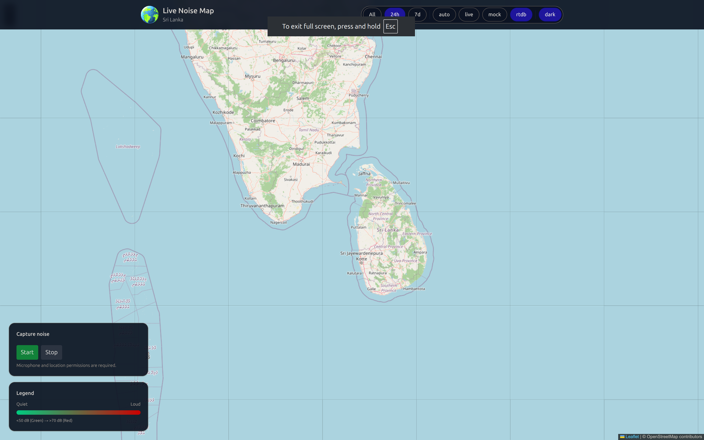
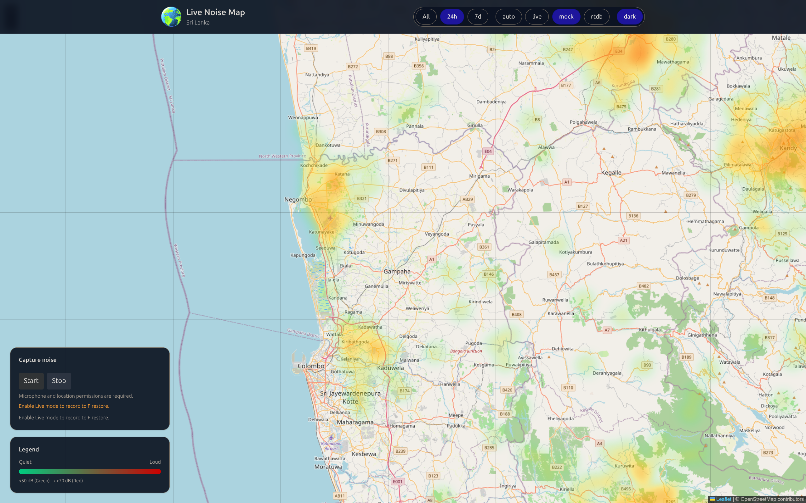
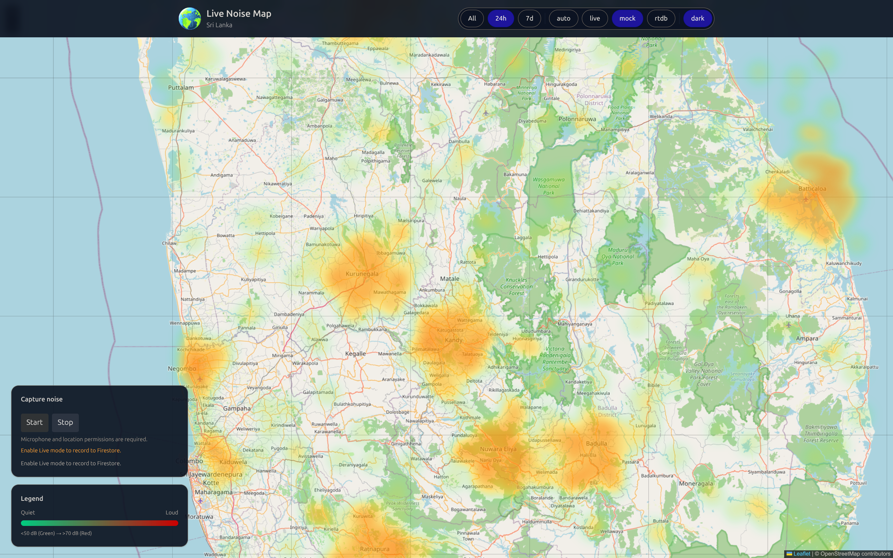

# Live Noise Map

Real-time, interactive heatmap of environmental noise across Sri Lanka. Data comes from browsers (Web Audio + Geolocation) and mobile devices, synced live via **Firebase Realtime Database**. The app renders an animated heatmap using Leaflet and `leaflet.heat`.

## Screenshots

<p align="center">
  
  
  
</p>

## Documentation

Comprehensive documentation lives in [`docs/`](docs/index.md):

| Doc | Contents |
|---|---|
| [Architecture](docs/architecture.md) | Repo layout, data flow, mode logic |
| [Web app](docs/web-app.md) | Setup, features, key-file walkthrough |
| [Mobile app](docs/mobile-app.md) | Expo setup, screens, WebView map bridge |
| [Data model](docs/data-model.md) | Schemas, field aliases, intensity mapping |
| [Firebase setup](docs/firebase-setup.md) | Config locations, rules, security notes |
| [API](docs/api.md) | Shared REST client endpoints |

## Table of Contents
- Overview
- Key Features
- Architecture
- Data Model
- Getting Started
- Development
- Modes (Auto / Live / Mock / RTDB)
- Firebase Setup (Firestore + RTDB)
- Security Notes
- Performance Notes
- Accessibility
- Roadmap and Backlog

## Overview
Live Noise Map visualizes noise intensity in real time. Each reading contains latitude, longitude, approximate dB level, and timestamp. The app supports:
- Browser capture (microphone + location)
- Firebase Firestore realtime sync
- Firebase Realtime Database (RTDB) sync
- Rich mock data for demos (constrained to Sri Lanka land polygon)

## Key Features
- Leaflet + leaflet.heat heatmap with green → yellow → red gradient
- Realtime updates from Firebase Realtime Database
- Web capture: approximate dB via Web Audio API + Geolocation API
- Mode toggle: Auto / Live / Mock / RTDB (all live modes use RTDB)
- Time filters: All / 24h / 7d (UI controls)
- Tailwind CSS UI (dev uses CDN assist; production uses PostCSS build)

## Architecture
- Frontend: React + Vite + Tailwind + Leaflet
- Data sync: Firebase (Firestore and/or Realtime Database)
- Heatmap: leaflet.heat layer fed with `[lat, lon, intensity]`
- Mock generator: clustered, background field, pulses, surges; constrained to Sri Lanka polygon

Directory highlights:
- `src/components/MapView.jsx` – Leaflet map + heat layer lifecycle
- `src/features/NoiseCapture.jsx` – Web Audio + Geolocation capture (Start/Stop)
- `src/features/HeatmapData.ts` – RTDB add/subscribe utilities (Firestore helpers retained but unused)
- `src/mock/data.ts` – Robust mock data generator
- `src/lib/firebase.ts` – Firebase init (Firestore + RTDB) using hardcoded config

## Data Model
Normalized sample (shared across sources):
```json
 {
  "lat": 6.9271,
  "lon": 79.8612,
  "dB": 72.4,
  "timestamp": "2025-08-20T11:30:00Z"
}
```

Firestore (collection `noise_samples`):
```json
  {
    "lat": 6.9271,
    "lon": 79.8612,
    "dB": 72.4,
  "timestamp": <Firestore Timestamp>
}
```

Realtime Database (path `noiseReports`) expected schema:
```json
{
  "noiseReports": {
    "<reportId>": {
      "latitude": 6.9271,
      "longitude": 79.8612,
      "dbValue": 72.4,
      "timestamp": 1692521400000
    }
  }
}
```
## IoT Pod (ESP32)
In addition to browser-based capture, the project includes a physical 
sensor pod built on ESP32 for the hackathon demo. The pod captures 
noise level (via I2S microphone) and GPS location (via TinyGPS++), 
then transmits readings to the backend for display on the live map.

- Hardware: ESP32 + I2S microphone + GPS module
- Firmware: `iot-npod/Noise_Pollution_Heatmap.ino`
- Data flow: Pod → WiFi → Firebase (Firestore/RTDB) → live heatmap

**Status:** The physical pod built for the hackathon demo has since 
been disassembled. The firmware is preserved here for reference. It 
was working and tested during the hackathon but has not been 
re-verified on hardware since.

**Note on credentials:** the firmware file uses placeholder values for 
WiFi and Firebase credentials — replace with your own before flashing 
to a device.

## Getting Started
Prerequisites:
- Node 18+
- npm 9+

Install and run dev server:
```
npm install
npm run dev
```
Production build and preview:
```
npm run build
npm run preview
```

## Development
- Main entry: `src/main.jsx`
- Tailwind directives in `src/index.css`
- Leaflet CSS imported in `src/main.jsx`
- Vite config: `vite.config.js`

## Modes (Auto / Live / Mock / RTDB)
Use the toggle in the header:
- Auto: Uses RTDB if configured; otherwise falls back to Mock
- Live: Subscribes to RTDB (`noiseReports` + `devices`)
- RTDB: Same subscription as Live (explicit selection)
- Mock: Animated mock dataset (no writes)

All live reads and writes go through Firebase Realtime Database. The Firestore code path in `src/features/HeatmapData.ts` (`subscribeToSamples`) is retained but currently unused.

When switching modes or time range, the app clears existing samples immediately to avoid mixing sources.

## Firebase Setup (Firestore + RTDB)
The project uses hardcoded Firebase config in `src/lib/firebase.ts`. Replace placeholders with your real project values (already populated if you edited them).

Enable services:
- Firestore Database
- Realtime Database

Testing rules (relax for local demo only – do not use in production):

Firestore rules (demo):
```
rules_version = '2';
service cloud.firestore {
  match /databases/{database}/documents {
    match /noise_samples/{doc} {
      allow read, write: if true;
    }
  }
}
```

RTDB rules (demo):
```json
{
  "rules": {
    "noiseReports": {
      ".read": true,
      ".write": true,
      "$reportId": {
        ".validate": "newData.hasChildren(['latitude', 'longitude', 'dbValue', 'timestamp']) && newData.child('latitude').isNumber() && newData.child('longitude').isNumber() && newData.child('dbValue').isNumber() && newData.child('timestamp').isNumber()"
      }
    }
  }
}
```

## Security Notes
- Do not ship open rules to production; lock down read/write access
- Consider authenticated writes for browsers; IoT devices should use a secure ingestion endpoint or custom token
- Avoid exposing private keys or secrets (Firebase web config is public but rules must protect data)

## Performance Notes
- Heat layer parameters tuned for contrast; adjust `radius`, `blur`, `minOpacity`, and gradient in `MapView.jsx`
- Intensity mapping boosts reds for >~70 dB; tune in `App.jsx` if needed
- Mock dataset uses ~1,800 points; reduce for low-end devices

## Accessibility
- High-contrast colors for gradient
- Keyboard-focusable controls for mode/time range
- Consider adding ARIA labels and descriptions for non-visual users

## Roadmap and Backlog
See `ROADMAP.md` for phased plan and `BACKLOG.md` for actionable next steps.

## Goals
- Implementing a SaaS
- Build dashboards for B2G systems
- Implementing Noise Alerts, Location comparisons in the app
- Storing historical datasets for Universities/NGOs
- Implementing AI/ML, to analyse noise and classify information
