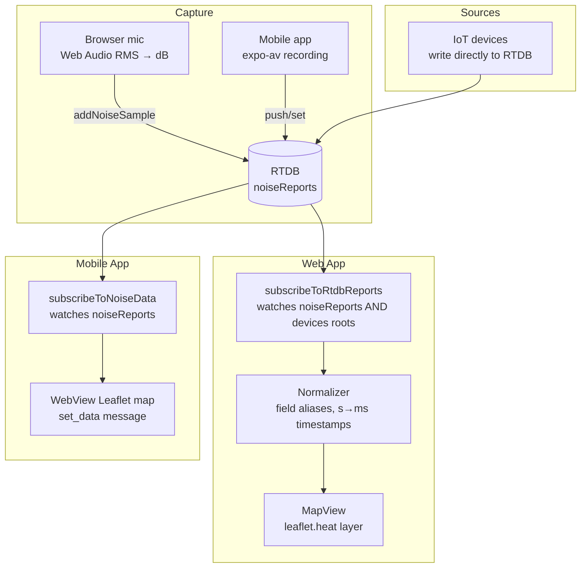

# Architecture

## Repo layout

This repository contains **two independent npm packages** (not linked by npm workspaces) plus a shared source folder:

```
Live-Noise-Map/
├── src/            # Web app (React 19 + Vite 7 + Tailwind 4) — entry: src/main.jsx
│   ├── components/MapView.jsx      # Leaflet map + heat layer lifecycle
│   ├── features/NoiseCapture.jsx   # Web Audio + Geolocation capture
│   ├── features/HeatmapData.ts     # RTDB read/write utilities
│   ├── lib/firebase.ts             # Firebase init (hardcoded config)
│   └── mock/data.ts                # Mock data generator
├── mobile/         # Expo SDK 53 / React Native app — own node_modules & lockfiles
│   ├── screens/                    # MapScreen, CaptureScreen, HistoryScreen
│   ├── lib/firebase.js             # Firebase init (duplicate of web config!)
│   ├── services/api.js             # REST wrapper over shared/api
│   └── metro.config.js             # Wires ../shared into Metro
├── shared/         # Plain TS/JS imported by relative path (no package.json, no build)
│   ├── api/index.ts + index.js     # Duplicate REST clients (.ts and .js must stay in sync)
│   └── constants/index.ts          # Noise thresholds, gradient
└── docs/
```

Key boundaries:

- The **web app never imports `shared/`** today; it has its own implementations in `src/features/` and `src/lib/`.
- Only `mobile/services/api.js` imports `shared/api/index.js`. Metro is configured in `mobile/metro.config.js` to watch `../shared` and resolve modules from both `mobile/node_modules` and the root `node_modules`, with hierarchical lookup disabled. Changing that config breaks `shared/` imports.
- Firebase web config is hardcoded in **two places that must be edited together**: `src/lib/firebase.ts` (web) and `mobile/lib/firebase.js` (mobile).

## Data flow



### Read path (web)

`subscribeToRtdbReports` (`src/features/HeatmapData.ts`) subscribes to **both** `noiseReports` and `devices` RTDB roots simultaneously. Each snapshot is walked recursively; any object that "looks like" a reading is extracted and normalized:

- Latitude aliases: `lat | latitude | Latitude`
- Longitude aliases: `lon | lng | longitude | Longitude`
- dB aliases: `dB | db | dbValue | decibels | spl`
- Timestamps: numeric values are treated as epoch seconds if `< 1e12`, otherwise milliseconds; strings are parsed with `Date.parse`.

Results from both paths are merged (250 ms debounce) and handed to the heatmap.

### Write path

- **Web:** `addNoiseSample` pushes `{ latitude, longitude, dbValue, timestamp (ms epoch) }` to `noiseReports`.
- **Mobile MapScreen:** pushes `{ lat, lon, dB, timestamp (ISO string), source, deviceId, locationName }` to `noiseReports` via `push()` + `set()`.
- Both write shapes are accepted on read because of the alias normalization.

### Legacy Firestore path

`src/features/HeatmapData.ts` also exports `subscribeToSamples` (Firestore collection `noise_samples`) and `src/lib/firebase.ts` exports `getDb()`. These are **defined but unused** by the current UI — all live reads/writes go through RTDB. Older documentation describing "Live mode = Firestore" is stale.

## Mode logic (web header)

Modes are selected by pills in the web header (`src/App.jsx`):

| Mode | Behavior |
|---|---|
| `auto` | Subscribes to RTDB if `getRealtimeDb()` returns an instance; otherwise falls back to mock |
| `live` | Same RTDB subscription as auto |
| `rtdb` | Same RTDB subscription, explicitly selected |
| `mock` | Generates ~1,800 points constrained to Sri Lanka, animates them every ~900 ms via `nudgeSamples` |

Switching mode or time range clears existing samples first so sources never mix.

Time-range pills (`all / 24h / 7d`) currently only re-trigger the effect; server-side filtering happens implicitly because the normalizer keeps every reading's timestamp and the mock regenerates. There is no cutoff query against RTDB today.

## Mobile architecture

- `MapScreen` embeds a self-contained HTML page (Leaflet + leaflet-heat loaded from unpkg) inside a `react-native-webview`.
- RN ↔ WebView communication:
  - RN → WebView: `injectJavaScript` dispatches a `message` event carrying JSON `{ type, data }` where type is one of `set_data`, `set_dark_mode`, `set_heatmap`.
  - WebView → RN: `window.ReactNativeWebView.postMessage(...)` sends `"Map Ready"` or `{ type: 'marker_click', data: point }`.
- Data source toggle in options: **Mock** (800 generated points, nudged every 4 s) vs **Live** (RTDB subscription).
- Sound capture uses `expo-av`; if native recording fails it falls back to simulated dB values.

## Theming (web)

- CSS custom properties defined in `src/index.css` under `:root`, overridden by a `.theme-dark` class that `App.jsx` toggles on `<html>`.
- Tailwind v4 runs through `@tailwindcss/postcss` (see `postcss.config.cjs`); legacy `@tailwind base/components/utilities` directives are used in `index.css`.

## Known quirks

- `shared/api/index.ts` and `shared/api/index.js` are hand-maintained duplicates — edit both together.
- Root ESLint allows unused variables starting with `[A-Z_]` (`varsIgnorePattern`), intentional for component-style imports.
- No tests exist anywhere; no TypeScript compiler is installed at the root (TS files are transpiled by Vite/Metro without checking).
